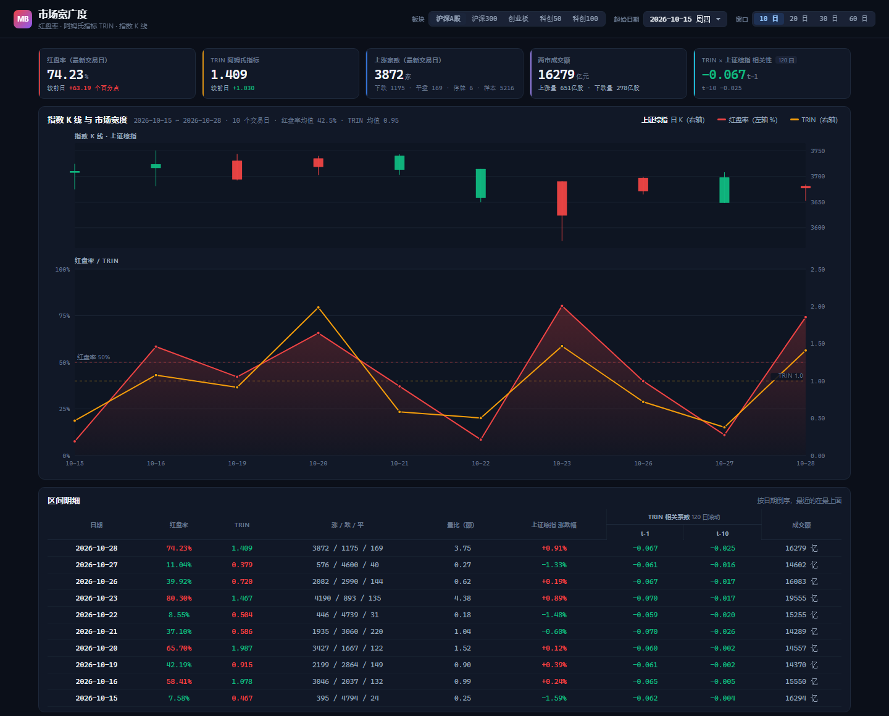

# 市场宽广度 · Breadth

> 每天自动更新的市场情绪看板：把**红盘率**和**阿姆氏指标（TRIN）**画在同一张双轴图上，用来看当天市场的「宽度」到底好不好。

**看板地址**：<https://alpha9527-daniel.github.io/Market-Breadth/>（仓库建好后替换为实际地址）



---

## ⚠️ 免责声明

- 本项目是**个人学习与研究**项目，**不是投资顾问服务，不构成任何投资建议、要约或推荐**。
- 作者**不具备证券投资咨询业务资格**，不提供任何形式的证券投资咨询服务。
- 页面数据均整理自公开渠道，可能存在延迟、缺失或错误，**不保证准确性与完整性**，请以交易所官方披露为准。
- 任何据此做出的投资决策及其后果，**由使用者自行承担**。
- 本项目**非商业用途**：不投放广告、不收费、不销售任何数据或服务。
- 数据版权归原发布方所有。若本站内容侵犯了您的权益，请在本仓库提 Issue，将第一时间删除。

---

## 这是什么

| 指标 | 含义 | 读法 |
|---|---|---|
| **红盘率** | 上涨家数 ÷（上涨＋下跌＋平盘） | 越高说明赚钱效应越普遍；20% 以下是普跌，80% 以上是普涨 |
| **阿姆氏指标 TRIN** | （上涨家数 ÷ 下跌家数）÷（上涨成交量 ÷ 下跌成交量） | 低于 1 说明成交向上涨股集中（偏多）；高于 1 说明下跌股吃掉了更多成交（偏空） |
| **量比（额）** | 上涨股票成交额 ÷ 下跌股票成交额 | 金额口径的资金流向，避免低价股被「股数」放大 |
| **相关系数** | TRIN 滞后 1 / 10 日后与**所属板块指数**涨跌幅的 **120 日滚动**皮尔逊相关 | 负值＝TRIN 走高时指数走弱（反向性），接近 0＝该滞后阶数下无稳定关系 |

红盘率只看「多少只股票在涨」，TRIN 额外把「成交量」也放进分母——同样是一半涨一半跌，
若上涨的股票成交更大，TRIN 会明显小于 1，说明资金在往强势股里流。两个指标一起看，
才能区分「普涨但有量」和「普涨但无量」。

**页面功能**

- 上半部分是**指数 K 线**，下半部分是**红盘率（左轴 %）+ TRIN（右轴）**，两张图共用一条横轴，日期严格对齐。
- 默认展示**最近 10 个交易日**；**起始日期**下拉可回看任意历史区间（终点固定为最新交易日），另有 10 / 20 / 30 / 60 日快捷按钮。
- **板块切换**：沪深 A 股 / 沪深 300 / 创业板 / 科创 50 / 科创 100——切换后宽度样本、K 线指数、相关系数一起变。
- 顶部 5 张指标卡（红盘率、TRIN、上涨家数、成交额、相关系数）+ 区间明细表（9 列，全部居中）。
- 前端**零依赖**：没有框架、没有 CDN、没有构建步骤，图表是手写的 SVG（`docs/app.js`）。

## 目录结构

```
build_breadth.py                  # 采数 + 算指标 + 导出前端 JSON（唯一的脚本）
requirements.txt                  # akshare / pandas / requests
run_daily.bat                     # 本地一键运行 (Windows)
.github/workflows/daily_breadth.yml   # 云端每交易日收盘后自动运行
data/
  cache/xsec/YYYYMMDD.csv.gz      # 每个交易日的个股横截面（可复算，保留最近约一年）
  cache/cons/{指数}.csv           # 各板块成分股（7 天刷新）
  cache/index/{指数}.csv          # 指数日线（K 线图数据源）
  breadth_history.csv             # 指标历史（沪深 A 股口径）
docs/                             # 看板本体（GitHub Pages 从这里发布）
  index.html  app.js  style.css
  data/breadth.json               # 前端读取的序列（走 http(s) 时用这个）
  data/breadth.js                 # 同一份数据的内嵌版，双击打开 index.html 时用这个
```

## 数据流水线

1. **当日快照（1 次请求）**：`ak.stock_zh_a_spot()` 一次拿到全部沪深 A 股的涨跌幅、成交量与成交额，
   归档为 `data/cache/xsec/YYYYMMDD.csv.gz`。
2. **历史回补（按需）**：若区间内有关键交易日没有归档（首跑、或某天 Actions 失败），
   用 `ak.stock_zh_a_daily()` 逐股拉日线补齐——12 线程约 15 分钟跑完 5200 只，**只跑一次**。
3. **指数与成分股**：指数日线走腾讯行情接口（6 个指数各 0.3 秒）；成分股走 `ak.index_stock_cons()`，
   本地缓存 7 天（沪深 300 首次约 3 分钟，之后直接读缓存）。
4. **指标计算**：由横截面归档按板块聚合出红盘率、TRIN、量比，再套 120 日滚动相关系数。
5. **导出**：`docs/data/breadth.json`（+ 内嵌版 `.js`），GitHub Pages 直接读取。

交易日历用 `ak.tool_trade_date_hist_sina()`，所以周末、节假日不会产生空行。
快照只在**收盘后**（15:05 之后）记为当日数据；盘中和次日开盘前运行会自动归到正确的交易日，不会把盘中数据写进库。

## 本地运行

```bash
pip install -r requirements.txt
python build_breadth.py                 # 补齐最近 120 个交易日 + 导出（首次约 15 分钟）
python build_breadth.py --rebuild       # 不联网，用本地归档重算并导出 JSON
python build_breadth.py --limit 300     # 冒烟测试：只取 300 只股票，不写当日归档

# 本地预览看板（任选一种）
python -m http.server 8000 -d docs      # 推荐：打开 http://localhost:8000
# 或者直接双击 docs/index.html —— 也能看到数据（会读 data/breadth.js 里的内嵌数据）
```

> **为什么有两份数据文件**：浏览器禁止 `file://` 页面 `fetch` 本地 JSON，所以
> `build_breadth.py` 同时写出 `breadth.json`（走 http(s) 时用，保证拿到最新一天）
> 和 `breadth.js`（双击打开时用）。直接双击看到的永远是"上一次构建"的结果，重新跑脚本才会更新。

## 指标口径

单日横截面按股票逐只判定，`pct` 为当日涨跌幅（%），`volume` 为成交量（股）：

| 项 | 规则 |
|---|---|
| 有效样本 | `volume > 0` 且涨跌幅非空；**停牌、无成交的股票从分子分母中全部剔除** |
| 上涨 / 下跌 / 平盘 | `pct > 0.0001` / `pct < -0.0001` / `\|pct\| <= 0.0001` |
| 红盘率 | `上涨家数 / (上涨 + 下跌 + 平盘) × 100` |
| TRIN | `(上涨家数 / 下跌家数) / (上涨成交量 / 下跌成交量)` |
| 量比（额） | `上涨成交额 / 下跌成交额` |
| 相关系数 | `滚动相关(TRIN.shift(k), 板块指数涨跌幅, 窗口=120)`，k = 1 或 10 |

两个边界处理：

- `下跌家数 = 0` 或 `下跌成交量 = 0` 时 TRIN 无定义，写为空值，图上断开而不是画一个假的极端值；
- 若某日抓取覆盖率低于 90%，该日**不写入归档**（下次运行自动重试），避免用残缺样本算出失真的红盘率。

**样本范围**：沪深 A 股，**不含北交所**（北交所成交与家数与主板不可比，混进来会稀释宽度信号）。
如需调整，改 `build_breadth.py` 顶部的 `UNIVERSE_PREFIX`。

**板块口径**：沪深 A 股＝全部沪深两市；沪深 300 / 创业板 / 科创 50 / 科创 100 按**当前成分股**
回溯计算历史（用今天的成分去算过去，存在一定的成分调整偏差，指数换样本时会略有跳变）。

## 数据来源与版权

- 行情经 **[AKShare](https://akshare.akfamily.xyz/)** 取自新浪财经、东方财富等**公开数据源**。
- 本仓库的**代码**可供参考，但**数据本身的版权归原发布方**，请勿用于商业用途。

## 部署到 GitHub Pages

### 第一步：把本目录变成一个独立的仓库

本文件夹已经是**独立仓库的根目录**（`git init` 已经做过，首个 commit 也已提交）：
仓库根 = `2. 权益/阿姆仕/`，看板在 `docs/`，所以 Pages 的发布目录就是 `/docs`。

在 GitHub 上新建一个**空仓库**（不要勾选 README / .gitignore / license），例如 `Market-Breadth`，
然后在本目录执行：

```bash
git remote add origin https://github.com/Alpha9527-Daniel/Market-Breadth.git
git push -u origin main
```

> 第一次 push 会要求登录：用 GitHub 的 **Personal Access Token**（Settings → Developer settings →
> Personal access tokens → Fine-grained tokens，勾 `Contents: Read and write`），
> 或者在装了 Git Credential Manager 的机器上走浏览器授权。

### 第二步：打开 Pages

仓库 **Settings → Pages**：

- Source 选 **Deploy from a branch**
- Branch 选 **`main`**，目录选 **`/docs`**
- 保存后等 1 分钟，地址是 `https://Alpha9527-Daniel.github.io/Market-Breadth/`

### 第三步：给 Actions 写权限

仓库 **Settings → Actions → General → Workflow permissions** 选 **Read and write permissions**，
否则每日任务无法把新数据提交回仓库（会报 `Permission denied` / `protected branch`）。

### 第四步：手动跑一次验证

**Actions → 市场宽广度每日更新 → Run workflow**。跑完应该看到：

- 日志最后一行 `最新 2026-xx-xx：红盘率 xx.xx% TRIN x.xxx ...`
- 仓库里多一条 `每日市场宽广度数据 YYYYMMDD` 的 commit（由 `github-actions[bot]` 提交）
- 页面刷新后数据日期前进一天

### 定时规则

`cron: '5 9 * * *'` = **UTC 09:05 = 北京时间 17:05**，每个交易日**收盘后**自动跑，
抓的是**当天**的收盘数据。想改成早上出报表（抓上一交易日），把 workflow 里的 cron 换成：

```yaml
- cron: '0 21 * * *'    # UTC 21:00 = 北京时间次日 05:00
```

两个已知的 GitHub 侧限制，提前知道省得踩坑：

1. **定时任务可能延迟**：高峰期 cron 常晚 5–20 分钟，属正常现象，不影响数据正确性
   （脚本按交易时段判断数据归属，17:05 之后跑都算当日）。
2. **60 天无活动会被自动停用**：仓库长期没人工提交时，GitHub 可能暂停 schedule，
   去 Actions 页面点一下 `Enable workflow` 即可恢复。每天的数据提交通常能维持活跃状态。

## 路线图

- [ ] 补一条「上涨家数占比的 20 日均线」作为慢速基准
- [ ] 相关系数增加滚动窗口可选（60 / 120 / 250 日）
- [ ] 并入个人研究博客，作为「市场情绪」板块

## 许可

- **代码**：个人研究项目，仓库未附开源许可证；转载或引用请注明出处。
- **数据**：版权归原发布方，不适用本仓库的任何授权。

---

*Maintained by [@Alpha9527-Daniel](https://github.com/Alpha9527-Daniel) · 仅供研究参考，据此操作风险自负。*
